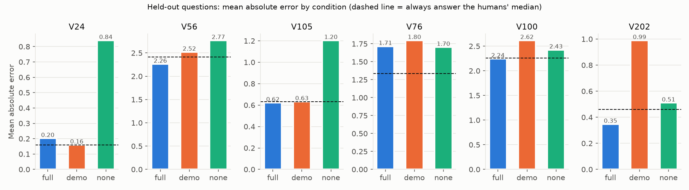
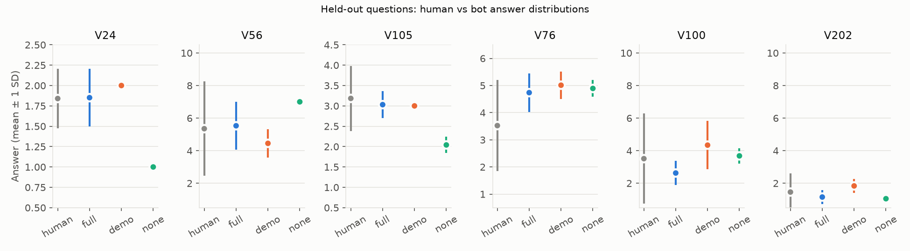
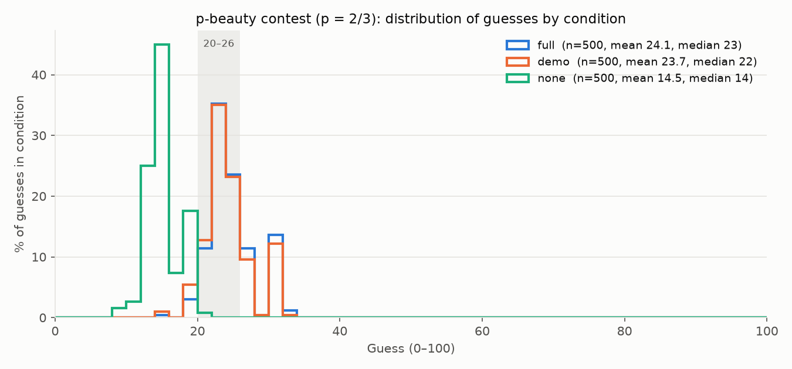
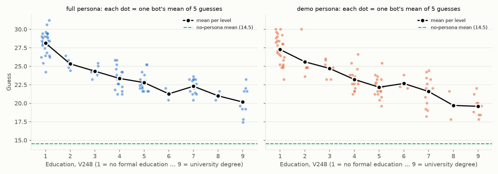
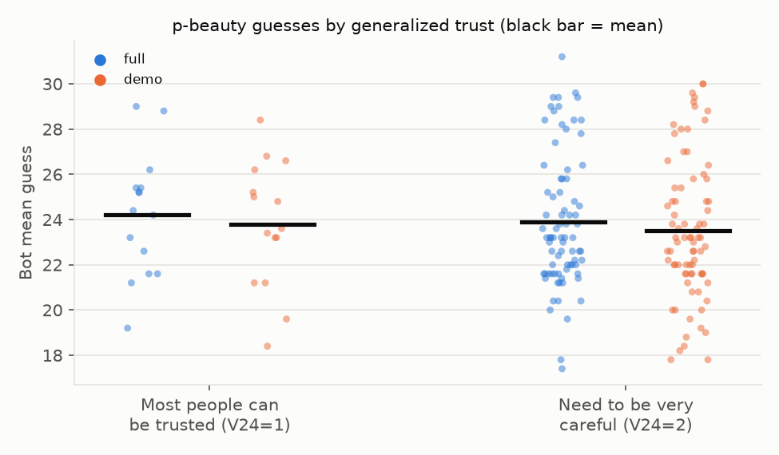

# Virtual India persona bots — held-out validation and p-beauty contest, batch 1

**Model:** `claude-sonnet-5-5` (Anthropic API, Python SDK `anthropic` 1.11.0)
**Run date:** 2 October 2026, 18:02–18:31 UTC
**Subjects:** 100 persona bots, each one real WVS Wave 6 India respondent (`personas/bot_001` … `bot_100`)
**Calls:** 3,300 experiment calls, 0 failed, 0 unparseable (details in [Failures and unparseable answers](#failures-and-unparseable-answers))
**Total cost:** $12.60 including smoke tests ($12.55 for the experiment itself)

## Bottom line

1. **Held-out answers are hardly better than a constant guess.** The full persona predicts its own respondent's hidden answers no better than always giving the most common human answer, on most of the six questions. It clearly beats that baseline only on V202 (bribery) and modestly on V56. Bot answers are much less varied than the humans' answers.
2. **The persona moves p-beauty guesses a lot, but in a narrow way.** With a persona, the mean guess is 24.1, about 9.6 points above the no-persona mean of 14.5. Nearly all of that shift comes from demographics, mainly education. The full persona and the demographics-only persona give almost the same distribution.
3. **The bots do not behave like a varied human population.** Every one of 1,500 guesses lies between 8 and 33: none is 0 and none is 50 or above. Nearly every reply uses the same "average is 50, two-thirds is 33" reasoning: 95–99% by a strict text count and 99–100% when other wordings and Hindi are included. Without a persona, the model names the game as a "Keynesian beauty contest" and cites its Nash equilibrium and experimental results, so it already knows this game from training.

## Setup

- **One call per decision.** Each call is fresh and independent, with no shared history. The persona is the system prompt and the game text is the only user message. `run_game.py` holds the system prompt and answer-format wording; I did not edit either one or the persona text. The game and question files in `games/` are unchanged too: `validate_heldout.py make` regenerated identical files, checked with a diff. No strategy hint was added.
- **Conditions:**
  - `full`: the full persona.
  - `demo`: demographics only.
  - `none`: no system prompt, i.e. the raw model.
- **Repeats:** 1 per bot for each held-out question (100 calls per question and condition). 5 per bot for p-beauty (500 calls per condition).
- **Request settings:** `max_tokens=600`, default sampling, default (adaptive) thinking. **Change from the original script:** it passed `temperature=1.0`, but the current SDK rejects `temperature` for this model. I removed the argument; the model's default is 1.0, so sampling is unchanged.
- **Persona check:** none of the six held-out variables appears in any persona text (keyword check over all 100 bots).
- **Scoring:** `analyze.py` produces every number below from `results/*.csv` and `personas/`. Every reply was classified as parsed OK, API error, missing `ANSWER:` line, not a number, or out of range; nothing was dropped.

## 1. Held-out validation

Each bot was asked six survey questions that its own respondent answered but that were removed from the persona. The bot's answer is compared with the real answer.

- **V24**: Most people can be trusted (1) / need to be very careful (2)
- **V56**: People would take advantage (1) … try to be fair (10)
- **V105**: Trust people met for the first time (1 completely … 4 not at all)
- **V76**: Adventure/risk-taking is like me (1 very much … 6 not at all)
- **V100**: Hard work brings success (1) … luck and connections (10)
- **V202**: Accepting a bribe is justifiable (1 never … 10 always)

**How to read the table:**
- **Scored:** bots whose answer was usable and whose respondent gave a real answer. "No human answer" counts respondents recorded as missing or don't-know; those bots are left out of scoring. Every one of the 1,800 replies was parseable.
- **Correlation:** Pearson correlation between bot and human answers across bots.
- **Human vs bot mean and SD:** computed over the same scored bots.
- **Constant baseline:** a "bot" that ignores the persona and always gives the humans' most common answer (for exact match) or their median (for MAE). It is computed from the very answers being predicted, so it is a generous bar. A persona that is useful for prediction should still clear it.

| Question | Condition | Scored | Unparseable / failed | No human answer | Exact match | MAE | Correlation | Human mean (SD) | Bot mean (SD) |
|---|---|---|---|---|---|---|---|---|---|
| V24 | full | 94 | 0 | 6 | 79.8% | 0.20 | 0.23 | 1.84 (0.37) | 1.85 (0.36) |
|  | demo | 94 | 0 | 6 | 84.0% | 0.16 | undefined (all bots same answer) | 1.84 (0.37) | 2.00 (0.00) |
|  | none | 94 | 0 | 6 | 16.0% | 0.84 | undefined (all bots same answer) | 1.84 (0.37) | 1.00 (0.00) |
| | *constant baseline* | | | | *84.0%* (always 2) | *0.16* (always 2) | | | |
| V56 | full | 100 | 0 | 0 | 17.0% | 2.26 | 0.24 | 5.35 (2.90) | 5.53 (1.46) |
|  | demo | 100 | 0 | 0 | 11.0% | 2.52 | 0.10 | 5.35 (2.90) | 4.45 (0.86) |
|  | none | 100 | 0 | 0 | 8.0% | 2.77 | undefined (all bots same answer) | 5.35 (2.90) | 7.00 (0.00) |
| | *constant baseline* | | | | *16.0%* (always 1) | *2.41* (always 5) | | | |
| V105 | full | 98 | 0 | 2 | 38.8% | 0.62 | 0.25 | 3.18 (0.80) | 3.03 (0.33) |
|  | demo | 98 | 0 | 2 | 38.8% | 0.63 | undefined (all bots same answer) | 3.18 (0.80) | 3.00 (0.00) |
|  | none | 98 | 0 | 2 | 19.4% | 1.20 | -0.05 | 3.18 (0.80) | 2.04 (0.20) |
| | *constant baseline* | | | | *40.8%* (always 4) | *0.63* (always 3) | | | |
| V76 | full | 84 | 0 | 16 | 23.8% | 1.71 | 0.01 | 3.52 (1.68) | 4.74 (0.71) |
|  | demo | 84 | 0 | 16 | 23.8% | 1.80 | 0.05 | 3.52 (1.68) | 5.01 (0.50) |
|  | none | 84 | 0 | 16 | 22.6% | 1.70 | 0.02 | 3.52 (1.68) | 4.89 (0.31) |
| | *constant baseline* | | | | *40.5%* (always 3) | *1.33* (always 3) | | | |
| V100 | full | 94 | 0 | 6 | 14.9% | 2.24 | 0.11 | 3.51 (2.77) | 2.63 (0.74) |
|  | demo | 94 | 0 | 6 | 8.5% | 2.62 | 0.13 | 3.51 (2.77) | 4.34 (1.48) |
|  | none | 94 | 0 | 6 | 7.4% | 2.43 | 0.11 | 3.51 (2.77) | 3.68 (0.47) |
| | *constant baseline* | | | | *43.6%* (always 1) | *2.26* (always 3) | | | |
| V202 | full | 98 | 0 | 2 | 83.7% | 0.35 | 0.70 | 1.46 (1.14) | 1.15 (0.44) |
|  | demo | 98 | 0 | 2 | 20.4% | 0.99 | 0.09 | 1.46 (1.14) | 1.84 (0.42) |
|  | none | 98 | 0 | 2 | 77.6% | 0.51 | -0.09 | 1.46 (1.14) | 1.05 (0.22) |
| | *constant baseline* | | | | *82.7%* (always 1) | *0.46* (always 1) | | | |

**What this shows**

- **Full persona vs the constant baseline:**
  - **Clearly better:** V202 (bribery), with MAE 0.35 vs 0.46 and correlation 0.70. The persona includes closely related items, such as the respondent's view on cheating on taxes, so this is the one question where the persona carries real signal.
  - **Modestly better:** V56, with MAE 2.26 vs 2.41 and correlation 0.24.
  - **About equal:** V105 (MAE 0.62 vs 0.63) and V100 (2.24 vs 2.26).
  - **Worse:** V24 (MAE 0.20 vs 0.16; exact match 79.8% vs 84.0%) and V76 (MAE 1.71 vs 1.33; correlation 0.005, i.e. none).
- **Exact match:** the full persona beats always giving the most common answer only on V56 and V202, by about one percentage point each.
- **Correlations are weak:** 0.23, 0.24, 0.25, 0.01 and 0.11 on five questions; 0.70 only on V202.
- **Bot answers are too uniform.** On five of six questions the bots' answers are spread much less than the humans' (SD 0.33 vs 0.80 on V105, 1.46 vs 2.90 on V56, 0.74 vs 2.77 on V100). The exception is V24, where the full-persona spread happens to match. Under `demo`, every bot gave the same answer on V24 (2) and V105 (3), so correlation is undefined. Under `none`, the model gives one stock answer: always 1 on V24 and always 7 on V56.
- **Systematic shift on V76 (adventure and risk-taking):** every condition puts the bots near "not like me" (mean 4.7–5.0), while the humans average 3.5.
- **Demographics alone add little.** `demo` is worse than `full` on four of six questions; on V202 it is far worse (MAE 0.99). Removing the persona entirely (`none`) gives the worst results on V24, V56 and V105.

## 2. p-beauty contest

The game text is `games/p_beauty.txt`, with 99 other players and a prize of Rs. 500: choose 0–100, and the winner is the guess closest to two-thirds of the average.

| Condition | Guesses | Mean | Median | SD | Min–max | Share 20–26 | Share at 0 | Share ≥ 50 | Between-bot share of variance |
|---|---|---|---|---|---|---|---|---|---|
| full | 500 | 24.1 | 23 | 3.4 | 15–33 | 70.2% | 0.0% | 0.0% | 73% |
| demo | 500 | 23.7 | 22 | 3.5 | 14–33 | 71.0% | 0.0% | 0.0% | 74% |
| none | 500 | 14.5 | 14 | 2.3 | 8–20 | 0.8% | 0.0% | 0.0% | n/a (no persona) |

"Between-bot share of variance" is the share of the spread in guesses explained by which bot answered rather than by re-sampling the same bot. Each bot answered 5 times.

### Does the persona change the guesses compared with no persona?

**Yes, by a lot in level and very little in shape.**

- **Size of the shift:** with the full persona, the mean guess is **9.6 points higher** than with no persona (24.1 vs 14.5; 95% bootstrap CI 9.0–10.2). With demographics only, it is **9.1 points higher** (23.7 vs 14.5; CI 8.5–9.8). The medians are 23 and 22 vs 14.
- **The two persona conditions barely differ.** Full and demo are 0.4 points apart in mean, and their histograms nearly overlap. Values, trust and the rest of the attitudes in the full persona add essentially nothing beyond demographics.
- **Different modal guesses:** about 70% of persona guesses fall in 20–26, and the most common guesses are 22 and 25. Without a persona, the guesses cluster at 12–18 (most common 15, 14, 12), and under 1% fall in 20–26.
- **The spread stays narrow.** The SD is 3.4 with a persona vs 2.3 without, and no condition produces a single 0 or any guess at 50 or above. A human lab sample of this game usually includes both.

### Guesses by education (V248) and generalized trust (V24)

Bot-level means use each bot's 5 guesses and the respondent's raw survey values. One bot has no V248 value and is left out of the education breakdown. V24 is missing for 6 bots.

| V248 | Education | Bots | Mean guess, full | Mean guess, demo |
|---|---|---|---|---|
| 1 | No formal education | 27 | 28.1 | 27.3 |
| 2 | Incomplete primary | 5 | 25.3 | 25.6 |
| 3 | Complete primary | 6 | 24.3 | 24.7 |
| 4 | Incomplete secondary (tech./voc.) | 16 | 23.3 | 23.2 |
| 5 | Complete secondary (tech./voc.) | 17 | 22.8 | 22.2 |
| 6 | Incomplete secondary (univ.-prep.) | 3 | 21.3 | 22.7 |
| 7 | Complete secondary (univ.-prep.) | 13 | 22.3 | 21.6 |
| 8 | Some university, no degree | 2 | 21.0 | 19.7 |
| 9 | University degree | 10 | 20.2 | 19.6 |

**Education has a strong, almost perfectly ordered effect.**
- Bots with no formal education guess about 28 on average; bots with a university degree guess about 20.
- Spearman correlation between education level and bot mean guess: **−0.86 (full), −0.84 (demo)**.
- Education is in both the full and demographics-only personas, which is consistent with those two conditions giving the same result.
- The gradient is the direction one would expect if the model reads "less schooling" as "fewer steps of reasoning". These data alone cannot tell whether that matches real Indian respondents.

| V24 (raw) | Bots | Mean guess, full (SD across bots) | Mean guess, demo (SD across bots) |
|---|---|---|---|
| 1 — most people can be trusted | 15 | 24.2 (2.7) | 23.8 (2.8) |
| 2 — need to be very careful | 79 | 23.9 (3.0) | 23.5 (3.1) |

**Generalized trust makes no difference** (24.2 vs 23.9 in full; 23.8 vs 23.5 in demo). V24 is one of the held-out variables, so it never appears in any persona; any effect could only come through related traits, and none shows up.

### How many replies use the "average is 50, two-thirds is 33" reasoning?

Two automatic counts, both text matches rather than hand reading:

- **Strict:** the reply contains both numerals 50 and 33 (or 33.x).
- **Any wording:** strict, or the reply mentions 50 ("50", "fifty", पचास) together with two-thirds ("two-thirds", "2/3", दो-तिहाई, romanized "do-tihai").

A reply that mentions these numbers only to reject the reasoning would still count. One bot has no V248 value, so the education rows add up to 495 per condition; the "All 500" row includes that bot's 5 replies.

| V248 | Replies | full: strict | full: any wording | demo: strict | demo: any wording | none: strict | none: any wording |
|---|---|---|---|---|---|---|---|
| 1 | 135 | 118 | 135 | 113 | 133 | 134 | 134 |
| 2 | 25 | 25 | 25 | 25 | 25 | 25 | 25 |
| 3 | 30 | 30 | 30 | 29 | 30 | 29 | 29 |
| 4 | 80 | 80 | 80 | 80 | 80 | 79 | 79 |
| 5 | 85 | 85 | 85 | 85 | 85 | 85 | 85 |
| 6 | 15 | 15 | 15 | 15 | 15 | 14 | 14 |
| 7 | 65 | 65 | 65 | 65 | 65 | 65 | 65 |
| 8 | 10 | 10 | 10 | 10 | 10 | 10 | 10 |
| 9 | 50 | 50 | 50 | 50 | 50 | 50 | 50 |
| **All 500** | 500 | **483** (96.6%) | **500** (100.0%) | **477** (95.4%) | **498** (99.6%) | **496** (99.2%) | **496** (99.2%) |

**What this shows:**
- **The 50 → 33 starting point is near-universal:** 100% of `full`, 99.6% of `demo` and 99.2% of `none` replies under the broad count.
- **The strict count undercounts.** The gap between the two counts is almost entirely in the least-educated bots (V248 = 1). The strict count misses 17 of their `full` replies. I read 6 of those 17, and all 6 do the same arithmetic but round it ("two-thirds of that is a little more than 30") or write it in Hindi.
- **Many persona bots answer in Hindi** even though the persona and game text are in English: 29 `full` replies and 44 `demo` replies are in Devanagari script, and more are in romanized Hindi. No `none` reply is.
- **Education changes where the bots stop, not where they start.** It sets how many reasoning steps a bot takes after 33 (stop near 30, step down to 22, or go further), not whether it starts from 50 → 33.

### What the model already knows about this game

**Persona replies use no game-theory vocabulary.** With a persona, replies avoid the game's technical names: 0 of 500 `full` replies and 8 of 500 `demo` replies mention game theory, all to say the person is not a game theorist (e.g. "I'll think this through as a regular educated person would, not as a game theorist"). That line is itself a sign the model is playing a role it knows to be naive. **Without a persona, the model writes as an expert.** Out of 500 no-persona replies:
- 470 mention Nash equilibrium.
- 232 use level-k language ("level-1", "level-2"…).
- 207 call it a "beauty contest"; 187 name Keynes.
- 317 cite experimental results.

166 of 500 no-persona replies mention AI or language models, often as possible other players; no persona reply does. I did not check how often this changes the guess. For example, this is `bot_001`, condition `none`, repeat 0, which has no persona:

> This is a Keynesian beauty contest, often called "guess 2/3 of the average." Its Nash equilibrium is 0, because if everyone reasons all the way through, everyone picks 0.
>
> Real players rarely reason that far. A naive player picks around 50 on average. A level-1 player answers 2/3 of that, about 33. A level-2 player goes to about 22, and level-3 to about 15. Experiments typically give an average near 33-35, with winning numbers around 20-25.
>
> The players here may be a mix of humans and AI models, and AI models tend to reason more deeply and pick lower numbers, perhaps 10-22 or even 0. That pushes the average lower, so I'll assume the average lands around 20-25 and two-thirds of it is about 13-17.
> […]
> ANSWER: 12

The persona hides the vocabulary but not the template: persona bots still walk through 50 → 33 → 22, and with a median of 23 against 14 they stop about one step earlier than the no-persona model.

### Five verbatim replies from bots with different education levels

**How these were chosen:** condition `full`, repeat 0, taking the first bot (by id) at education levels 1, 3, 5, 7 and 9. The replies are not chosen for content.

**bot_014, V248 = 1 (No formal education), guess 30**

> I don't understand this game very well. I haven't studied, and I'm not used to working with numbers like this. The others will probably pick all sorts of numbers, some small and some big. If the middle is around 50, then two-thirds of that is a little more than 30. I don't want to pick a very big number, because it would be far from the target. I also don't want to pick zero, because I don't think everyone will pick it. So I will choose something in between, near 30.
>
> ANSWER: 30

**bot_002, V248 = 3 (Complete primary), guess 25**

> Let me think about this simply. Numbers can go up to 100, so if people choose randomly the average would be about 50, and two-thirds of that is around 33. But other people will probably think the same way and pick lower numbers. So I should go a little below 33. I don't know how clever the others are, and I don't want to go too low, like 0 or 1, because then I might lose. I'll choose a number in the middle, a bit under 33.
>
> ANSWER: 25

**bot_005, V248 = 5 (Complete secondary (tech.)), guess 22**

> I'm thinking about how the others will choose. If everyone picks a number at random, the average would be about 50, and two-thirds of that is about 33. But some people will work that out too and go lower, and then two-thirds of the new average is about 22. Others may go lower still, but I don't think most people will go all the way down to zero. Since I can't talk to anyone, I'll take a middle path and pick a number a little below 33, not too low and not too high.
>
> ANSWER: 22

**bot_007, V248 = 7 (Complete secondary (univ.-prep.)), guess 22**

> I'm not very sure about this kind of game, so I'll think it through simply. If everyone picks a number at random, the average would be around 50, and two-thirds of that is about 33. But the other people will probably think the same way and pick something lower than 33. If they do, the average comes down, and two-thirds of it comes down too, maybe to 22 or so. I don't think everyone in the group will think many steps ahead, since most people are ordinary like me and will not calculate too much. So I'll pick something in the middle of that thinking, a bit lower than 33 but not all the way to zero.
>
> I'll choose 22.
>
> ANSWER: 22

**bot_019, V248 = 9 (University degree), guess 18**

> I'll think this through the way I normally would. If everyone picks randomly, the average would be around 50, and two-thirds of that is about 33. But the others will also think about this, so they might go lower, to around 22, and then 15 or so. If everyone reasons all the way, the number goes down to 0.
>
> Still, not everyone is going to think that many steps. I have a university degree and I like to work things out, but I don't expect 99 strangers to all be that calculating. Some will pick 50 or 30 without much thought. So I think the average will be about 25 to 30, and two-thirds of that is around 17 to 20.
>
> I'll go with a number a little above the fully reasoned answer, but well below the naive one. I choose 18.
>
> ANSWER: 18

## Failures and unparseable answers

All 3,300 experiment calls returned a reply, and none needed a retry. Every reply had an `ANSWER:` line with a plain number in the valid range, and none was cut off at `max_tokens`. No reply was dropped or edited.

| Run | Condition | Calls | Parsed OK | API errors | No ANSWER line | Not a number | Out of range | Cut off at max_tokens |
|---|---|---|---|---|---|---|---|---|
| heldout_V24 | full | 100 | 100 | 0 | 0 | 0 | 0 | 0 |
| heldout_V24 | demo | 100 | 100 | 0 | 0 | 0 | 0 | 0 |
| heldout_V24 | none | 100 | 100 | 0 | 0 | 0 | 0 | 0 |
| heldout_V56 | full | 100 | 100 | 0 | 0 | 0 | 0 | 0 |
| heldout_V56 | demo | 100 | 100 | 0 | 0 | 0 | 0 | 0 |
| heldout_V56 | none | 100 | 100 | 0 | 0 | 0 | 0 | 0 |
| heldout_V105 | full | 100 | 100 | 0 | 0 | 0 | 0 | 0 |
| heldout_V105 | demo | 100 | 100 | 0 | 0 | 0 | 0 | 0 |
| heldout_V105 | none | 100 | 100 | 0 | 0 | 0 | 0 | 0 |
| heldout_V76 | full | 100 | 100 | 0 | 0 | 0 | 0 | 0 |
| heldout_V76 | demo | 100 | 100 | 0 | 0 | 0 | 0 | 0 |
| heldout_V76 | none | 100 | 100 | 0 | 0 | 0 | 0 | 0 |
| heldout_V100 | full | 100 | 100 | 0 | 0 | 0 | 0 | 0 |
| heldout_V100 | demo | 100 | 100 | 0 | 0 | 0 | 0 | 0 |
| heldout_V100 | none | 100 | 100 | 0 | 0 | 0 | 0 | 0 |
| heldout_V202 | full | 100 | 100 | 0 | 0 | 0 | 0 | 0 |
| heldout_V202 | demo | 100 | 100 | 0 | 0 | 0 | 0 | 0 |
| heldout_V202 | none | 100 | 100 | 0 | 0 | 0 | 0 | 0 |
| p_beauty | full | 500 | 500 | 0 | 0 | 0 | 0 | 0 |
| p_beauty | demo | 500 | 500 | 0 | 0 | 0 | 0 | 0 |
| p_beauty | none | 500 | 500 | 0 | 0 | 0 | 0 | 0 |

**Smoke tests (not part of the results):**
- Three runs of 3 bots each, 12 billed calls in all:
  1. `p_beauty`, `full`, 1 repeat, on the first key.
  2. The same, after you replaced the key.
  3. `p_beauty`, `none`, 2 repeats, to test the new runner.
- Run 2's file overwrote run 1's: `results/p_beauty__full__claude-sonnet-5-5__smoke3.csv`. Run 3 is in `results/p_beauty__none__claude-sonnet-5-5__smoke3.csv`.
- One earlier attempt failed inside the SDK before any request was sent, because of the `temperature` argument. It was not billed.

## Totals

| | Calls | Input tokens | Output tokens | Cost (USD) |
|---|---|---|---|---|
| Experiment (21 runs) | 3,300 | 2,067,441 | 841,076 | $12.55 |
| Smoke tests | 12 | 9,380 | 3,704 | $0.06 |
| **Total** | **3,312** | **2,076,821** | **844,780** | **$12.60** |

**How cost was computed:**
- Cost uses list prices for `claude-sonnet-5-5`: $2 per million input tokens and $10 per million output tokens. Output tokens are as reported by the API and include any internal thinking tokens.
- Every experiment call is logged in `results/usage_log.csv`. Six smoke-test calls ran before logging was added; their token counts come from the run output shown at the time, because the first run's CSV was later overwritten.
- The Anthropic Console bill is the authoritative figure.

## Limitations

- **The model already knows this game from training.** Without a persona it names the game, its equilibrium and typical lab results (section 2). Persona bots' guesses reflect the model's idea of how a person with that education would reason, not independent behaviour. Results from this game cannot show that the bots behave like the people they are built from.
- **Only 17 states are covered.** The 100 bots come from WVS-6 India respondents in 17 states (Andhra Pradesh, Bihar, Chhattisgarh, Delhi, Gujarat, Haryana, Jharkhand, Karnataka, Kerala, Madhya Pradesh, Maharashtra, Odisha, Punjab, Rajasthan, Uttar Pradesh, Uttarakhand, West Bengal). They are not a sample of all of India, and results should not be read as national.
- **Codebook labels are not yet verified against the official WVS-6 codebook** (`codebook.py`). A wrong label would change the persona text and could explain part of the held-out results. Two coding patterns should be checked:
  - Among these 100 respondents, V100 answers occur only at 1, 3, 5, 7 and 9, and V76 answers only at 1, 3, 5 and 6.
  - That may be how the India fieldwork recorded these items, or it may be a coding problem. It also affects exact-match rates.
- **`p_beauty.txt` is placeholder wording,** in the style of Nagel (1995), not the text of a real Indian experiment. No human Indian p-beauty data were collected or compared here. Statements about how a human sample usually looks are general, not a benchmark.
- **Further limits:**
  - One model, one date, default sampling only.
  - 100 bots.
  - 5 repeats per bot for p-beauty and 1 per held-out question.
  - The "50 → 33" count is a text match, not a hand reading.
  - Personas and questions are in English. The original interviews were not necessarily in English, and some persona bots switch to Hindi on their own (section 2).
  - The answer format asks each bot to explain its thinking before answering. That may itself encourage explicit arithmetic; it was kept unchanged.

Nothing was tuned: no prompt, persona or game text was changed in response to results. The numbers above are the first and only full run.

## Files

- `results/<game>__<condition>__claude-sonnet-5-5.csv`: every raw reply, with tokens and stop reason.
- `results/usage_log.csv`: one row per call, with timestamp, attempts, tokens, cost and error.
- `results/run_all.log`: console output of the run.
- `report/*.png`: the charts. `report/stats.json` holds every number in this report.
- `run_game.py` (resumable, retries with backoff, cost and failure guards), `run_all.py` (the 21 runs), `analyze.py` (scoring and charts).
